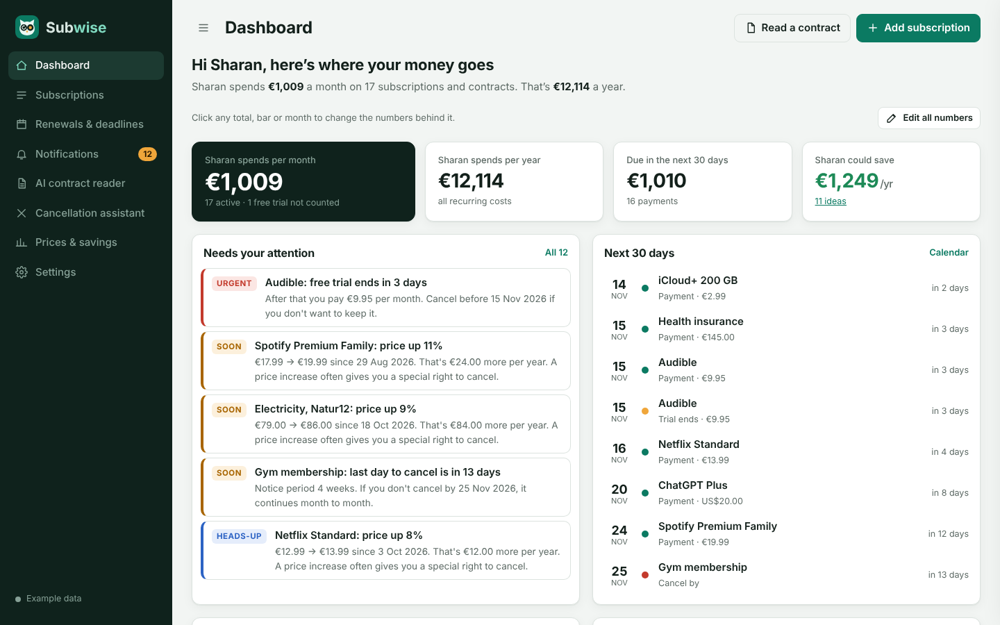
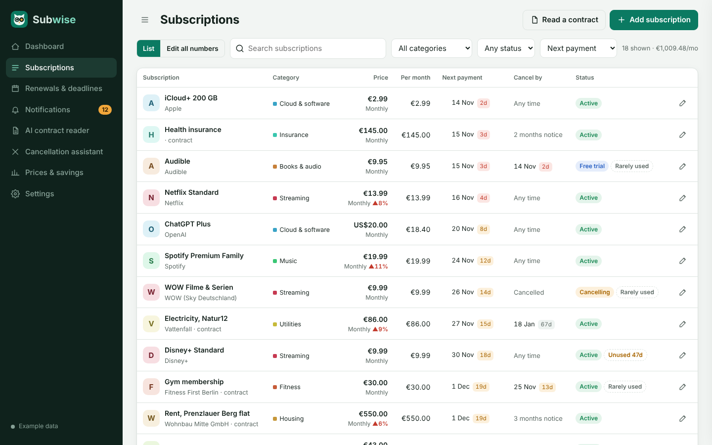
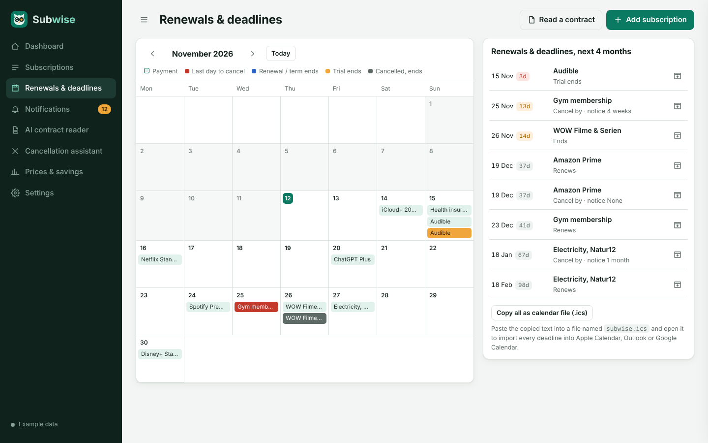
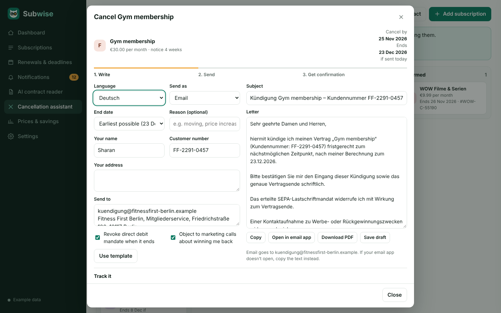
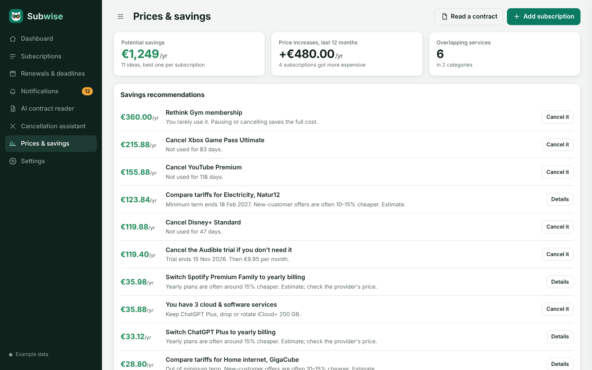

  

<h1 align="center">Subwise</h1>

<b>A personal subscription and contract radar.</b> 
Track every recurring cost, never miss a cancellation deadline, and find money to save.

  <a href="https://sharanvardhang17-arch.github.io/subwise/"><b>▶ Open the live demo</b></a>

## What it does

Subwise keeps all recurring costs in one place: streaming services, gym, rent, phone, internet, insurance and travel tickets. It works out what you spend, when each payment is due and the last day you can cancel, and reminds you in time.

The live demo opens with example data for a person living in Berlin, so every feature can be tried straight away.

## Features

| Feature | What it does |
|---|---|
| **Subscription management** | Add, edit and track subscriptions and contracts: price, currency, billing cycle, minimum term, notice period, payment method and usage. |
| **Expense dashboard** | Monthly and yearly totals, spending by category and a 12-month payment forecast. Every number can be edited and all charts recalculate live. |
| **Renewal tracking** | Calendar of renewals, minimum-term ends and trial endings, with Google Calendar links and an `.ics` export. |
| **Cancellation deadlines** | Calculates the last day to cancel from the notice period, including "only at the end of a month" rules. Reminders 30, 14, 7 and 1 day before. |
| **Smart notifications** | Upcoming payments, free trials ending, price increases, subscriptions not used for a long time and unconfirmed cancellations. |
| **Cancellation assistant** | Writes cancellation letters and emails in English or German, exports them as PDF and tracks each cancellation from draft to confirmed. |
| **Price increase detection** | Keeps a price history for each subscription and shows the percentage change and yearly impact. |
| **Savings recommendations** | Finds unused, overlapping and duplicate subscriptions, trials about to become paid and contracts worth comparing. |
| **Contract reader** | Reads uploaded PDF and Word contracts in the browser. In the Claude-hosted version, AI extracts prices, dates and conditions and explains risky terms in plain language. |

## Screenshots

| Subscriptions | Renewals & deadlines |
|---|---|
|  |  |

| Cancellation assistant | Prices & savings |
|---|---|
|  |  |

## How it's built

- **Single-page web app** in plain HTML, CSS and JavaScript, with no framework and no build step.
- **Date and money logic**: billing cycles, notice periods, minimum terms, renewals and end-of-month rules, with currency conversion to one base currency.
- **Data** is stored in the browser (`localStorage`), with JSON backup and restore and CSV export.
- **Libraries**: [pdf.js](https://mozilla.github.io/pdf.js/) for reading PDFs, [mammoth.js](https://github.com/mwilliamson/mammoth.js) for Word files and [jsPDF](https://github.com/parallax/jsPDF) for generating letters.
- **Design**: responsive layout for desktop and phone, light and dark mode, and a custom logo.

## Run it locally

Download `index.html` and open it in Chrome, Firefox, Safari or Edge. No installation needed.

## Limitations

- Reminders appear inside the app only (no push or email notifications).
- AI features (contract reading, summaries, AI-written letters) run only in the Claude-hosted version; this demo uses the built-in templates.
- Data stays in one browser on one device.

## Author

**Sharan**, designed and built with the help of Claude (Anthropic).
